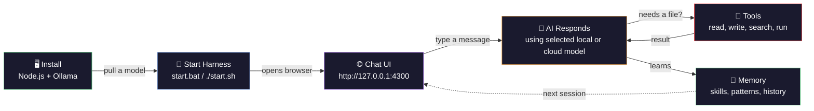

[](https://github.com/Bradliebs/ollama-agent-harness/releases/latest)

## What is this?

Ollama Agent Harness is a local-first agent runtime with a browser UI, tool dispatch, permissions, session management, and learning infrastructure. Local Ollama inference needs no cloud account. Configured cloud models, remote Ollama hosts, and network tools transmit data outside your machine; cloud execution may incur charges.

You chat with a model, it can call tools (read/write files, run bash, search the web, analyze images, transcribe audio, generate documents, send emails), and the harness manages permissions, context, and history.

**v0.6.4** brings semantic memory via the bundled `ccmem` concept-cell service (auto-started on port 8765), the **Apex** family of autonomous experiences (`/goal` natural-language expander, PDF → wiki blueprint, Kanban bridge, competitor-research renderer, personal memory wiki, daily morning-priority prompt), persistent workspace path so `start.bat` only asks once, and a smarter empty-synthesis fallback that leads with any files the model wrote and falls back to short labelled bullets instead of raw page dumps. See the [CHANGELOG](CHANGELOG.md) for the full history.

### What's new since v0.6.5 (in development)

Development work on `dev`; package metadata remains `0.6.5`. These changes are
not yet a new numbered release.

* Windows-first setup requires Node 22.13.0 or newer (24 LTS recommended), explicit model selection, and a confirmed Quick Test. Background launch preserves occupied ports; Stop targets only the owned server.
* Interrupted-session recovery reports partial transcripts and preserves append-only history. Ollama cancellation and retries, MCP stdio interoperability, and document dependencies have additional regression coverage.
* Cloud-only workflow testing can leave local GPUs available. The revised development cohort passed 36/36; the original frozen holdouts passed 12/24. These are different datasets, not a reliability guarantee or a like-for-like improvement.
* Full Jest verification passed 358 suites and 4,050 tests, with one skipped and exit code 0 (2026-10-08). Installer execution and hosted cross-platform CI remain separate gates. See [Modernization Status](docs/MODERNIZATION-STATUS.md) for evidence and limitations.

* **Autonomous Lead Agent** — hand the harness one task and the lead agent plans it into a graph of sub-agent workstreams, dispatches them in parallel via the orchestrator, verifies the merged result against the toolchain, and re-plans until it passes or a budget is exhausted — no human interaction. Use `HARNESS_LEAD=1` headless in the CLI, the `/auto <task>` chat command, or `POST /api/lead/run` (streaming). See [`docs/LEAD-AGENT.md`](docs/LEAD-AGENT.md).
* **Governed Agent Loop v1** — a shadow-first governance pass beside the product path: confidence-mode labels, per-answer self-critique, a working-memory snapshot, and a human-gated review queue that writes to durable memory only on explicit approval. Idle replays re-ask drained answers and re-enter the same review queue. See [`docs/GOVERNED-LOOP.md`](docs/GOVERNED-LOOP.md).
* **New HTTP surface** for the loop and supporting subsystems: `/api/working-memory`, `/api/review-queue/*`, `/api/replay-*`, `/api/governed-metrics`, plus `/api/webhooks/*` (including dead-letter redelivery) and `/api/mycelium/*` (router inspection, learning curve, feedback).
* **Workspace vs install** clarification — set `HARNESS_PROJECT_DIR` to keep user data out of the install dir, and promote user-wide credentials (e.g. SMTP) to OS env vars so they stop going stale per workspace. See [Workspace vs install](#workspace-vs-install).
* **Research answers cite sources** — answers built from web pages end with a numbered **Sources** list when the model included no links. `web_read` retries sites that block automated readers, and a 404 on a URL that never came from `web_search` is flagged as a guess.
* **Persona and turn status in the UI** — the top bar shows the assistant's name from `SOUL.md`, with a badge when the persona is missing or a proposal needs review. Failed, stopped, interrupted and empty replies get a **Retry** strip.
* **Workspace safety** — tests and smoke scripts no longer write into a real workspace, and [`scripts/repair-workspace.js`](scripts/repair-workspace.js) cleans up one that earlier runs polluted. See [Repairing a workspace](#repairing-a-workspace).
* **One launcher** — `start.bat` with `background`, `stop`, `tray` or `watchdog`.
* **Run logs and per-step undo** — every chat run is recorded in `.harness/runs/<runId>.jsonl`: message deltas, raw model responses, tool calls and full results, and compaction snapshots, so the exact prompt of any turn can be rebuilt. Recognised secrets (API keys, tokens) are redacted before anything is written. File changes made through the file tools are tagged with their step and can be rolled back to the end of any step (`GET /api/run-logs`, `POST /api/run-logs/<runId>/revert` with `toStepSeq`). Set `HARNESS_RUN_GIT_CHECKPOINT=1` to also snapshot the whole workspace per run (covers changes made via `bash`) and restore it with `POST /api/run-logs/<runId>/revert` and `{"mode":"git"}`; this discards any later edits in the workspace, but never touches `.harness/`. `HARNESS_RUN_LOG=0` turns recording off.
* **Run supervisor** — on by default. Tool steps that stop producing anything new (no new sources, files, results, verifier passes or plan steps) trigger a progress check, then a strategy change, and finally Moss stops and asks you what is blocking instead of looping. Per-run budgets stop a run into a summary: 1.5M tokens by default (`HARNESS_RUN_MAX_TOKENS`), plus an optional USD cap for priced models (`HARNESS_RUN_MAX_USD`). Loop-guard nudges and the tool-result injection tripwire are now on by default too. `HARNESS_SUPERVISOR=0` and `HARNESS_LOOP_HARDENING=0` turn them off.
* **Provenance checks on side effects** — on by default, including in `dontAsk` mode. Web, browser and inbound-email tool output is untrusted: it can inform Moss's decisions but cannot authorise an action by itself. If an email recipient, a URL, or a shell command in a side-effecting call (`email_send`, `email_draft`, `bash`, `docker_exec`, `browser_fill`, non-GET `web_fetch`) appears only in untrusted content and not in your messages or profile, Moss asks for your approval and shows where the value came from. Unattended runs deny such calls. It is a heuristic tripwire, not a guarantee: values the model invents are not flagged, and only the tools listed above are checked. `HARNESS_PROVENANCE=0` turns this off.
* **Model capability profiles** — `harness probe <model>` (or `POST /api/model-profiles/<model>/probe`) measures a model's native tool-calling reliability, JSON validity with and without schema-constrained output, instruction following, usable context (needle retrieval) and multi-step plan coherence, then saves `.harness/model-profiles/<model>.json` with recommendations. A fresh profile caps the context budget at the measured usable window. `HARNESS_ADAPTER_MODE=profile` additionally limits tools per step and switches weak tool-callers to JSON tool calls (schema-constrained where supported); it is opt-in, so A/B test it on your tasks first (`layers` in an experiment variant). [Getting more from your model](docs/MODEL-CAPABILITY.md) walks through probing, the opt-in layers and testing them. Probes only run when asked, because they spend tokens.
* **Adjustable scaffolding** — `HARNESS_SCAFFOLD_MODE=profile` (or `light`/`medium`/`heavy`) fits the structure to the model. **Medium:** plan first, the 10 most relevant tools, at most 3 calls per turn. **Heavy:** a plan-only first reply, one tool per step, a next-step prompt, and older tool results trimmed. `profile` uses the level recommended by the model's probe; measured profiles also replace the name-based "weak/strong tool use" guesses in the model picker. When a layer limits the tools, half the slots (at least three from five up) go to core tools (`file_read`, `bash`, `file_edit`, `grep`, …) and the rest to the tools most relevant to the whole conversation. The layers (adapter, scaffolding, working state, lesson recall) apply in the web chat, task mode, the CLI and the autonomy loop; the chat's tool activity (and the CLI's first lines) say which were applied and why any were skipped, for example a model that hasn't been probed. Opt-in; A/B test with an experiment first.
* **Governed working state** — protected paths are enforced before tools run: the task contract's blocked paths (`.env`, `.git/`, `secrets/`, …) plus anything in `.harness/protected-paths.json`. Patterns match at any depth: `name` covers a file or folder of exactly that name (`.env` does not cover `.env.local`), `dir/` and `dir/**` a folder and its contents, `*.pem` any matching file; a leading `/` anchors a pattern at the project root, as in `.gitignore`. Shell commands that write to them are caught too. `HARNESS_WORKING_STATE=on` adds a typed working state (plan, facts with sources, decisions with reasons, open questions, invariants, sources read). It is rendered into every system prompt (or, with `HARNESS_WORKING_STATE_POSITION=tail`, sent as the last message of each request), so compaction can never drop it, and the model gets a `state_update` tool that can add protections but never remove or displace them. The run log records the rendered state, so prompts still rebuild exactly.
* **Independent checks on research answers** — when an answer was built from pages Moss read, every figure in it (prices, counts, percentages, dates, phone numbers) is checked against the text of those pages. Differences, totals and percentages computed from sourced figures count as supported; your own question counts too. By default this only records a verdict (a "claims verified / unverified" line under the reply and a run-log entry) and leaves the answer unchanged. `HARNESS_VERIFY_RESEARCH=annotate` appends a short "could not be confirmed" note. `critic` also asks a critic model from a different family (for example, not GLM when GLM wrote the answer) to judge the flagged claims against the best-matching excerpts, trying the next candidate if one fails. `gate` does that and asks the worker for one revision before accepting an answer with unsupported claims. `HARNESS_CRITIC_MODEL` picks the critic; a same-family choice is ignored. With `HARNESS_INSPECTOR_ADVERSARY=1`, the adversary judge uses the critic too, falling back to the chat model if the critic call fails. On Moss's history, about one figure in five in research answers was not in any page read that turn, which is why annotation stays opt-in.
* **In-run escalation** — when chat routing is on (any mode except `off`), a run can switch to the strong-tier model partway through instead of failing. That happens when the supervisor finds it stuck (it tries a stronger model before asking you), or when the research gate rejects an answer a second time. The stronger model continues the same run with the full transcript and every tool offered natively. It happens at most once per run, is shown as "switched to a stronger model" under the reply, and is recorded as a run-log `route` event. If the strong tier is already the model doing the work, nothing changes. Per-turn routing (task type, risk and prompt size decide the tier) now uses measured capability profiles to spot weak tool callers.
* **Memory that has to earn its place** — after every chat, task and background run, Moss derives lessons from the run log without a model call. It notes sites that refused automated reading (for example a 403), requests that got stuck and what was repeated, answers whose figures no page supported, and runs that hit the budget. They are kept in `.harness/learning/lessons.json`. With `HARNESS_LESSONS=recall`, up to four relevant ones (recent blocked sites for research requests, plus lessons from similar requests) are added to the prompt and labelled as run history. Each recalled lesson is scored by whether the next run avoided the same failure, and one that keeps failing is retired. Blocked-site lessons go stale after 30 days, others after 120. `HARNESS_LESSONS=off` stops recording. Skills now record whether the runs that used them finished cleanly. Skills the agent writes (`create_skill`, `promote_pattern`, `improve_skill`) are safety-scanned with the promotion gate's rules, versioned in `_history/`, and start on probation until three runs that use them finish cleanly; the skill list and the skill itself show that standing. When the curator is enabled, it archives skills whose last three runs (two while on probation) failed; archived skills can be restored.
* **Token budgeting that matches what is sent** — on by default. The ~70 tool definitions (about 10k tokens) travel with every request; the context budget now counts them, along with tool-call arguments such as a whole file passed to `file_write`. Prior chat history is fitted beside the system prompt and tool definitions and kept under the compaction threshold, so long chats no longer compact (or pay for a summarizer call) on the first turn of every message. It is cut at fixed blocks of the conversation, so the same prefix is resent, and stays cacheable, for several messages in a row. Under pressure, long arguments of older tool calls are shortened before whole messages are dropped, and each auto-compaction folds in the previous summary instead of losing it. With windows under 32k tokens, memory files, the skill list, recall and identity are trimmed in proportion. Usage now includes the compaction summarizer's calls and, where the provider reports them, cached prompt tokens; each recorded request carries a `prefixHash` showing whether the cacheable prefix repeated.
* **Deferred tool loading** — `HARNESS_TOOL_LOADING=deferred` offers core tools (files, `bash`, `grep`, web search and read, skills, memory) plus the ones whose names or descriptions match the messages of the chat so far, and a `tool_search` tool that loads the rest on demand. That cuts tool definitions by about 75–85% per request. The offered set only grows, within a run and across a chat's messages, so the request prefix stays cacheable. A direct call to an unloaded tool runs if it has the required arguments; otherwise its parameters are returned and it is loaded. `auto` defers only when the definitions would take more than 20% of the context window. Opt-in until replay evaluation shows it helps.
* **Cache-friendly prompt layout** — `HARNESS_PROMPT_LAYOUT=cache` keeps the system prompt identical from message to message, so providers that cache prompt prefixes (OpenAI-style APIs, Ollama's KV cache) can reuse it and the history after it. Recall, attachments, routing and skill notes, recalled lessons, the task contract and output-validation instructions go into one `<harness_context>` message just before your message instead. `HARNESS_WORKING_STATE_POSITION=tail` does the same for the working state. Both are opt-in because they change where the model reads that context; some providers may not accept two user messages in a row.
* **Replay your own history against other models** — `harness replay <runId> --model <m> [--model <m2>]` re-runs a recorded chat with the same prompt against other models. Tool calls get the originally recorded results (exact match, else the next result for that tool, else "no recorded result"), so nothing real runs and only the model varies. The report compares completion, turns, tokens, cost, duration, cited sources, unsupported claims and stuck runs. `harness benchmark-history --models a,b --last 10` does this over your last N tool-using chats; `POST /api/replays` runs it from the UI server. Add `--live` to run read-only tools for real, and `--defer-tools` to evaluate deferred tool loading. The report also shows cached prompt tokens and how many distinct cacheable prefixes a run sent (1 means the prefix never changed). Replays measure cost, turns, stuck runs and unsupported claims rather than correctness, and reuse the recorded prompt, so they compare models and deferred tool loading; capability layers are A/B tested with the experiment runner (`layers` per variant, see [Getting more from your model](docs/MODEL-CAPABILITY.md)). Measuring commands (`probe`, `replay`, `benchmark-history`) never fall back to another provider, and accept `provider/model` ids such as `groq/llama-3.1-8b-instant` or `local/qwen3` in one run.

### What's new in v0.6.5

Shipped since the v0.6.4 release:

* **Build Mode** — a simplified, non-developer flow for describing a goal and letting the harness plan and build it.
* **`/wiki` and `/memory-wiki`** slash commands, plus research commands, built on reusable renderers.
* **Evidence-first verification** — a side-effect ledger and research skill that check work before presenting it.
* **Autonomy reliability fixes** — the Build-it loop now launches correctly in isolated workspaces and streams live tool activity to the dashboard.
* **`OLLAMA_HOST` support**, tool-output compression, and plain-English intent chips.

### 🌅 Apex-class autonomous experiences

A small family of end-to-end experiences composed from existing harness primitives: the `/goal` natural-language expander, a PDF → wiki blueprint, a triage/doing/done Kanban bridge that auto-promotes cards into the autonomy plan, a competitor-research report renderer, a personal memory wiki, and a daily morning-priority prompt. See [`docs/APEX-FEATURES.md`](docs/APEX-FEATURES.md) for the full tour with copy-pasteable commands.

## How it works



### Your first 5 minutes

```mermaid
graph TD
    S1["① Install Node.js<br/><i>nodejs.org → LTS → Next through everything</i>"] --> S2
    S2["② Install Ollama<br/><i>ollama.com → Download → ollama pull llama3.2</i>"] --> S3
    S3["③ Start the Harness<br/><i>Double-click start.bat or run ./start.sh</i>"] --> S4
    S4["④ Pick a model<br/><i>Choose llama3.2 from the dropdown</i>"] --> S5
    S5["⑤ Start chatting!<br/><i>Try: 'List the files in this project'</i>"]

    S1 ~~~ N1["💡 Already have Node?<br/>Skip to step 2"]
    S3 ~~~ N2["💡 No terminal?<br/>Just double-click start.bat"]

    style S1 fill:#16213e,stroke:#50c878,color:#e0e0e0,stroke-width:2px
    style S2 fill:#16213e,stroke:#50c878,color:#e0e0e0,stroke-width:2px
    style S3 fill:#16213e,stroke:#8ab4f8,color:#e0e0e0,stroke-width:2px
    style S4 fill:#16213e,stroke:#bb86fc,color:#e0e0e0,stroke-width:2px
    style S5 fill:#16213e,stroke:#ffb050,color:#e0e0e0,stroke-width:2px
    style N1 fill:#0d1117,stroke:#555,color:#888,stroke-dasharray:5 5
    style N2 fill:#0d1117,stroke:#555,color:#888,stroke-dasharray:5 5
```



## Quick start

### Prerequisites

* [Node.js](https://nodejs.org/) 24 LTS recommended, minimum 22.13.0
* For local inference: [Ollama](https://ollama.com/) with a model you choose (e.g. `ollama pull llama3.2`). Alternatively, explicitly configure a supported cloud provider.

### Option A — Windows installer (easiest)

Download **Harness-Setup.exe** from the [latest release](https://github.com/Bradliebs/ollama-agent-harness/releases/latest), run it, and double-click the desktop shortcut. The installer checks for Node.js and Ollama automatically.

### Option B — Double-click (from source)

1. Clone this repo
2. Double-click `start.bat` (Windows) or run `./start.sh` (Mac/Linux)
3. Open the URL printed by the server, normally **http://127.0.0.1:4300**. An occupied port causes selection of another port, not termination of its owner.

These launchers run the **assistant profile** (`HARNESS_PROFILE=assistant`) — the
same harness with its proactive "Jarvis" features (ambient daily brief, voice,
chat channels) on by default.

### Option C — Terminal (from source)

```powershell
npm install
npm run ui
```

Open the URL printed by the server. The terminal development path can use a
different default port from the launchers. This dev path runs a plain harness;
set `HARNESS_PROFILE=assistant` first to turn the proactive assistant features on.

### CLI mode

```powershell
npm run start -- -p "Summarize the project" --model llama3.2
```

Run `npm run start -- --help` for all CLI flags including `--mode`, `--max-turns`, `--validate-output`, and helper model routing.

Other subcommands (the full list with flags is in [System breakdown §6](docs/SYSTEM-BREAKDOWN.md#6-cli-commands)): `harness doctor [--fix] [--watch]` checks setup, `harness tui` opens the terminal client, `harness probe <model>` measures a model, `harness replay` and `harness benchmark-history` re-run recorded chats against other models, `harness simulate` runs the adversarial probes, and `harness mycelium <sub>` inspects the router graph.

### Validation

```powershell
npm run typecheck
npm test -- --runInBand
```

With the UI server running, smoke-test the browser. The smoke creates chats,
services and uploads through the API, so it refuses to reuse a running server
unless you name it explicitly or pass `--reuse`; never point it at the server
holding your real workspace:

```powershell
npm run smoke:ui -- http://127.0.0.1:4300/
```

To validate the current checkout without accidentally reusing a stale local UI
server, run the fresh smoke. It starts its own server on the default smoke port
in a throwaway workspace, and fails if that port is already occupied:

```powershell
npm run smoke:ui:fresh
```

To inspect local automation jobs without modifying runtime state, build first
and run the automation job audit:

```powershell
npm run build
npm run audit:automation-jobs
```

To archive known test-created duplicate automation jobs after reviewing the
audit output, run the cleanup command. It writes an archive JSON under
`.harness/automations/archive/` before updating the active jobs file:

```powershell
npm run cleanup:automation-jobs -- --apply
```

Smoke-test the Mycelium API route-inspection surface with a temporary seeded
graph:

```powershell
npm run build
npm run smoke:mycelium
```

Run a paired AutoResearch experiment when you want to compare a baseline model,
prompt, skill, or routing configuration against a candidate with frozen
benchmark evidence:

```powershell
npm run experiment:run -- --manifest cookbook/auto-research.manifest.example.json --dry-run
```

See [AutoResearch experiments](docs/AUTORESEARCH-EXPERIMENTS.md) for the
manifest shape, execution command, history views, and promotion-evidence rules.

Tests and smoke scripts that need `.harness/**` state should create the fixture
inside the test or script and restore the prior state before exiting. Do not
depend on ignored local files already existing in a developer checkout.

For local timeout checks against a real Ollama model, run the optional
long-prompt smoke after building:

```powershell
npm run build
npm run smoke:long-prompt
```

Override the model, host, prompt size, timeout, or context window with
`HARNESS_LONG_PROMPT_MODEL`, `OLLAMA_HOST`, `HARNESS_LONG_PROMPT_LINES`,
`HARNESS_LONG_PROMPT_TIMEOUT_MS`, and `HARNESS_LONG_PROMPT_NUM_CTX`.

## Operating services

Agentic Service Mode handles ongoing service requests before model selection.
Requests such as reminders, bullet journals, and daily site checks create local
operating services under `.harness/services/` instead of asking the model to
build an app or write task files.

See [Operating Services](docs/OPERATING-SERVICES.md) for the storage contract,
deterministic commands, scheduler behavior, Discovery detail flow, and
model-agnostic routing rules.

## Autonomy mode

Run the harness against itself, draining `IMPLEMENTATION_PLAN.md` task by
task, with no human in the loop:

```powershell
$env:HARNESS_MODEL = "kimi-k2.5:cloud"   # see model matrix below
$env:FORGE_MAX_ITERATIONS = "10"
npm run autonomy            # full run
npm run autonomy:dry        # preview one iteration without spending tokens
npm run autonomy:stop       # graceful stop signal
npm run autonomy:reset      # clear .forge-state.json + .forge-stop
```

Tasks in `IMPLEMENTATION_PLAN.md` may declare anchors (read-only file
context the model gets inline) and a target (the file to edit):

```markdown
- [ ] verify-permissions-deny-first — Add a focused jest test under `src/permissions/`...
  - anchor: src/permissions/engine.ts
  - anchor: src/permissions/engine.test.ts
  - target: src/permissions/engine.test.ts
```

Live progress: `.forge-state.json` (one-shot), `.forge-history.jsonl`
(append-only per iteration), `.forge-run.log` (mirrored console output),
`.forge-debug.jsonl` (raw model exchanges, only with `HARNESS_DEBUG_LOG`
set or `npm run autonomy:debug`). The web UI surfaces the autonomy HUD
in the topbar with a click-through log tail modal.

### Model capability matrix

What we measured running real autonomy iterations on this codebase
(May 2026). "Writes correct code" means the model picked the task,
called `file_write`/`file_edit`, and produced output that passed
`npm run typecheck`.

| Model | Backend | Tool calls | Writes correct code | Notes |
|---|---|---|---|---|
| `kimi-k2.5:cloud` | ollama (Pro) | ✅ native | ✅ **yes** with anchors | First model to land an autonomy commit end-to-end. Recommended. |
| `gpt-oss:120b-cloud` | ollama | ✅ native | ⚠️ writes code, often wrong code | Explores well but may scaffold generic structure instead of doing the task. |
| `gpt-oss:20b-cloud` | ollama | ✅ native | ❓ untested at length | Same family as 120b, ~6× faster. |
| `qwen3-coder:480b-cloud` | ollama | ❌ chats | ❌ no | Refuses to use tools on this codebase. |
| `deepseek-v3.1:671b-cloud` | ollama | ❓ untested | ❓ untested |  |
| `qwen2.5-coder:14b` | ollama (local, ~9GB) | ✅ but wrong tools | ❌ no | Loops on `reflect`/`promote_pattern`, ignores tool whitelist. |
| `qwen2.5-coder:7b` | ollama (local, ~4GB) | ⚠️ JSON-as-text | ❌ no | Mitigated by inline tool-call parser; still picks wrong tools. |
| `gemma4:e4b`, `gemma4:26b` | ollama (local) | ❌ chats | ❌ no | Conversational only. |
| `llama3.1-8b` | cerebras | ✅ but wrong tools | ❌ no | Hallucinates `recall`/`remember`; only Cerebras free model accessible. |
| `gpt-oss-120b` | cerebras | ❌ 404 on free | ❌ no | Listed in `/v1/models` but free tier returns 404. |
| `qwen-3-235b-a22b-instruct-2507` | cerebras | ⚠️ rate-limited | ❓ untested | Free RPM is shared at the tier level; usually 429s. |
| `gpt-4.1`, `gpt-4.1-mini`, `o3-mini` | github | ❓ untested | ❓ untested | High expected value; needs `GITHUB_TOKEN` with Models scope. 50-150 RPD free. |
| `kimi-k2-instruct` | groq | ❓ untested | ❓ untested | Same Kimi lineage; free, 14,400 RPD. |

Backends are configured via `HARNESS_BACKEND` (or `--backend` flag) plus
the appropriate `*_API_KEY` env var. `harness doctor` lists every
configured backend and reports whether its key is set.

#### Local model servers (Strata, llama.cpp, LM Studio, vLLM)

Models that Ollama can't run well can be served by another local engine with an OpenAI-compatible API, for example [Strata](https://github.com/Niko1221/Strata), which runs a 125B mixture-of-experts model on a 12 GB gaming GPU by spreading it over GPU, RAM and SSD. The harness talks to it as the `local` backend:

* Start the server. Strata and llama.cpp's `llama-server` listen on `http://127.0.0.1:8080/v1` by default; for LM Studio (`:1234`) or vLLM (`:8000`) set `HARNESS_LOCAL_BASE_URL`, e.g. `http://127.0.0.1:1234/v1`.
* Its models appear in the model picker as `local/<model>` while it is running (CLI: `HARNESS_BACKEND=local`).
* It is treated as local: no API key (set `HARNESS_LOCAL_API_KEY` if you started the server with one), $0 in the cost readout, no daily-spend cap, and never a fallback target, so nothing leaves the machine. That holds for an address on this machine (`127.0.0.1`, `localhost`); a server on another host still works, but the conversation goes there and the cost readout says it doesn't know where the model runs.
* Requests are streamed, and replies show live in the web chat. `HARNESS_LOCAL_TIMEOUT_MS` (default 10 minutes) is the longest wait for output, because local engines read long prompts slowly (Strata: about a minute per 30,000 tokens); once text flows it applies to silence between chunks, so long answers aren't cut off. A thinking model that writes no answer shows its reasoning instead, and an empty reply is asked for again.
* The context window comes from `HARNESS_LOCAL_CONTEXT_WINDOW`, else from llama.cpp-style servers' `/props`, else 32K. Set it to the context you chose when starting the server.
* The model needs working tool calls for agent tasks (llama.cpp: start it with `--jinja`). Use **Probe model** to check.

### Recommended models for tool use

Not every model can call tools. These are the ones that work with the harness.

#### Local Ollama — best picks

| Model | Size | Best role | Pull command |
|---|---|---|---|
| `qwen3:8b` | ~5 GB | Main local agent | `ollama pull qwen3:8b` |
| `qwen3:14b` | ~9 GB | Better planner | `ollama pull qwen3:14b` |
| `qwen2.5-coder:7b` | ~4 GB | Coding agent | `ollama pull qwen2.5-coder:7b` |
| `qwen2.5-coder:14b` | ~9 GB | Stronger coder | `ollama pull qwen2.5-coder:14b` |
| `llama3.1:8b` | ~5 GB | Stable fallback | `ollama pull llama3.1:8b` |
| `phi4-mini` | ~2 GB | Fast router | `ollama pull phi4-mini` |
| `devstral` | ~15 GB | Coding agent | `ollama pull devstral` |
| `mistral-small3.2` | ~15 GB | Function calling | `ollama pull mistral-small3.2` |
| `granite4.1:8b` | ~5 GB | Structured tasks | `ollama pull granite4.1:8b` |
| `gemma4:26b` | ~16 GB | Heavy reasoning | `ollama pull gemma4:26b` |

Quick start set (fits most GPUs):

```powershell
ollama pull qwen3:8b
ollama pull qwen2.5-coder:7b
ollama pull phi4-mini
ollama pull llama3.1:8b
```

#### Mistral API (free tier)

| Model ID | Best role |
|---|---|
| `mistral-small-latest` | General agent — best starting point |
| `devstral-small-latest` | Coding agent — test first |
| `codestral-latest` | Code generation specialist |
| `ministral-8b-latest` | Cheap router |
| `magistral-small-latest` | Reasoning/review |
| `mistral-medium-latest` | Better planner (rate-limited) |
| `mistral-large-latest` | Highest quality (use sparingly) |

Configure with `MISTRAL_API_KEY` and `--backend mistral`.

#### Recommended stack

```text
Planner:   qwen3:8b (local) or mistral-small-latest (API)
Coder:     qwen2.5-coder:7b (local) or devstral-small-latest (API)
Router:    phi4-mini (local) or ministral-8b-latest (API)
Reviewer:  llama3.1:8b (local) or magistral-small-latest (API)
```

## UI tabs

The browser UI keeps five primary tabs in the left sidebar, with everything else under a **More** (⋯) menu:

| Tab | What it does |
|-----|-------------|
| 💬 **Chats** | Your past conversations; new/export sessions |
| 📁 **Files** | Browse files in this project |
| ⚡ **Abilities** | Reusable instructions (skills) the AI can follow |
| 🧠 **Memory** | What the AI remembers across sessions |
| ⚙ **Automations** | Saved sequences of AI actions (workflows under `.harness/workflows/`) |

The **More** menu groups the remaining tabs:

| Group | Tabs |
|-------|------|
| **Build & use** | 🤖 Agents · 👥 Squads · ⚡ Triggers · ✅ Tasks · 🪪 Identity |
| **Search & knowledge** | 🔎 Search Files (vector index) · 🏛 Memory Bank (semantic memory) · 🔮 Discoveries · 🧬 Code Intel |
| **History & diagnostics** | 📜 Runs · 📋 Events · 🛡 Activity Log · 📈 Learning · 💓 Health |
| **Admin & backup** | 🛠 Tools (registry, permissions, kill switch, capability grants) · 📦 Backups · 📎 Generated Files |
| **Advanced** | 🚀 Autonomy · 🍄 AI Router (adaptive routing network) · 🤝 Commitments |

The right side has a **Settings** panel for Ollama host, generation parameters, model routing, media tools, output validation, and safety mode. Settings are saved to `.harness/settings.json`.

## Key concepts

### Tools

Built-in tools include `file_read`, `file_write`, `file_edit`, `file_move`, `file_delete`, `make_directory`, `bash`, `list_files`, `grep`, `web_fetch`, `web_search`, `web_read`, `image_analyze`, `audio_transcribe`, `document_export`, `email_send`, `email_draft`, `create_skill`, `install_skill`, `desktop_screenshot`, `browser_bookmarks`, `browser_navigate`, `browser_click`, `browser_fill`, `browser_read`, `browser_screenshot`, `browser_close`, `calendar_read`, `calendar_write`, `slack_notify`, `telegram_notify`, and more. Each tool has a risk level (low/medium/high) and can be individually disabled from the Tools tab.

Browser tools (`browser_navigate`, `browser_click`, `browser_fill`) are disabled by default and require a capability grant — they interact with live websites via Playwright.

The `bash` tool spawns a single executable without a shell. Shell control operators (`;`, `|`, `&&`, redirects, command substitution) outside quoted arguments are rejected — quote them and they pass through verbatim (e.g. `python -c "import x; print(x)"`). Use `make_directory` instead of `mkdir`, `file_read`/`list_files` instead of `cat`/`dir`, the `cwd` argument instead of `cd dir && …`, and pipe through a script file instead of `cmd`-style pipes. On Windows, `.cmd`/`.bat` scripts (such as `gradlew.bat`) run through `cmd.exe`, and a timeout ends the whole process tree. Long output keeps its first 10,000 and last 40,000 characters, because compilers and test runners print errors and summaries last.

### Coding tools and verification

* `file_read` returns files exactly as on disk, up to 12,000 bytes by default, cut at a whole line with a note naming the next `start_line`. The results of the latest tool calls reach the model in full, up to half the context window between them; older results are shortened to 4,000 characters. Dispatch-time compression never touches `file_read` output, so `file_edit` can copy from it.
* `file_write` with `append: true` adds to the end of a file, so a file too large for one reply can be written in parts.
* When a reply is cut off at the model's output limit, the agent is asked to carry on where it stopped (up to twice in a row). A tool call cut off part-way is never run, because its arguments are incomplete; the model is asked to write the file in smaller parts. A thinking model that used the whole limit before answering is asked to answer directly. When the conversation has filled the model's context window, continuing can't help, so the chat says so instead.
* `file_edit` replaces one exact, unique occurrence. It writes the file's own line endings. When the text isn't found it points at lines that match apart from whitespace, and when it occurs more than once it lists the lines.
* `list_files` takes `recursive: true` or a `pattern` glob (`"src/**/*.{ts,tsx}"`). `grep` prints project-relative paths, takes the same globs in `include`, and says when it stopped at 200 matches. Both skip dependency and build folders (`node_modules`, `dist`, `build`, `out`, `coverage`, `target`, `__pycache__`, `vendor`) and dot-folders; grep also skips dot-files (such as `.env`) and binary files.
* When code verification is on (the CLI turns it on when the project has `package.json`; `HARNESS_VERIFY=1` forces it on), the loop runs typecheck, ESLint and the tests in the project directory after the agent changes files. It detects npm, pytest, `go test` and `cargo test`. Web chat turns it on for coding tasks. Web pages written in the run are checked too: inline scripts must parse and the local files they link to must exist. A failing check is sent back to the model once to fix (`verify.repairAttempts`); a missing tool or a timeout counts as "not verified", not as a failure.
* Web chat gives coding tasks (edits and debugging) at least 10 minutes of wall-clock time, so editing, running checks and one fix fit even on a slow local model. Other chats keep the automatic budget (3 minutes for local models, 10 for cloud, or what the model's measured turn time suggests); a time budget set in Settings always wins.
* The CLI requests and budgets the same context window as the web chat: the window the model reports (up to 200,000 tokens), capped by the per-model or global `contextMaxTokens` setting and by a fresh capability profile. Set `contextMaxTokens` in Settings (or `.harness/settings.json`) to limit GPU memory use.
* Project instructions: `HARNESS.md`, `AGENTS.md` (the cross-tool convention read by Codex, Copilot and Cursor, among others) and `CLAUDE.md` in the project root are added to the system prompt. A file with the same text as one already included (a symlink, say) is skipped, and together they use at most 16,000 characters on a 32k-token window (less on smaller ones); `forge-memory/patterns.md` has its own allowance.
* The CLI's interactive mode keeps the conversation between prompts; `/clear` (or `/new`) starts a new one and `/quit` exits.

### Chat

* **Watch it write.** The reply appears as the model writes it (Ollama and local servers; cloud providers show it when finished). What stays is the final, checked answer, so it can change a little at the end; `HARNESS_STREAM_TEXT=0` turns the live view off. Stopping keeps what was written so far.
* **Plan first.** `/plan add a dark mode toggle` runs read-only (it can read and search, but nothing that changes files, runs commands or widens folder access) and replies with a plan. It isn't available in compare mode. **▶ Run this plan** under it carries the plan out, with the usual approvals.
* **Build rules for coding tasks.** When a message is a coding task (an edit, a fix, or a request to build an app, site or game, such as "make me a snake game in JavaScript"), the agent is told to deliver complete, working code with no placeholders, stay in scope, and check its work by running the project's tests or build, instead of the general "do more" rules other chats get. Coding tasks get up to 20 turns (or your turn limit, if lower).
* **Preview what it built.** When a reply writes a web page, the page opens in the side panel (`index.html` first) with its own CSS, scripts (modules too), images and data files, and the reply has **▶ Preview** buttons for it (two at most). **↗ New tab** opens it full size. It is served sandboxed, so its scripts can't reach the harness, and it can load only files from its own folder (plus anything on the internet). A page directly in the project folder gets its CSS, images and classic scripts, but not modules or `fetch()` of its files, so its scripts can't read the whole project; pages in a subfolder (such as `agent-outputs/`) get everything. `localStorage` is blocked there, so a page that saves state should catch that error (the build rules ask for this).
* **Highlighted code.** Code blocks in replies are syntax-highlighted for common languages (JavaScript/TypeScript, Python, shell/PowerShell, JSON, CSS, HTML/XML, YAML, SQL, diffs and C-like languages), with no extra download.
* **Mention files with `@`.** Typing `@` in the message box suggests project files; `@src/app.ts` puts the file's current contents into the message (up to five files and a quarter of the context window, cut at whole lines), so the model doesn't need to read it first; for a very large file only the start is read. The tool activity shows which files went in and which mentions weren't found. `.harness/` and `.git/` are never inlined, but anything else you mention is, `.env` included, so don't mention files whose secrets shouldn't reach the model.
* **Approve with the change in view.** Approval cards show the diff for `file_edit`, the start of the file for `file_write`, the whole command for `bash`, and the recipient for email. **Approve all edits** also approves file edits for the rest of that chat, including the rest of the run that asked, so they stop prompting (commands still ask). It works when Safety mode is *Default* and doesn't change the saved mode, so other chats and automations still ask.
* **Undo a reply's changes.** A reply that changed files has **↩ Undo changes**, which rolls back the edits its run recorded through the file tools (also after you stop a run). Changes made by shell commands aren't recorded this way; see `HARNESS_RUN_GIT_CHECKPOINT` for whole-workspace snapshots.
* **Type while it works.** Pressing Enter while a reply is streaming queues your message; it's sent when the reply finishes. Stop (or Esc) still stops the run, and a queued message then goes back into the message box.
* **Edit and resend.** **✏️ Edit** on one of your messages changes it and runs the conversation again from there. File changes made by the replies it replaces stay on disk (it warns you); undo them first if you want them gone.
* **Reading back.** The chat follows new output only while you're at the bottom; scroll up and it stays put, with **Jump to latest** to return.
* Follow-ups know what happened: each earlier reply is sent with a one-line summary of the tools it used (files read and edited, commands and whether they failed), and a stopped or failed turn stays in the history.

### Allowed External Paths

File tools are confined to the project directory by default. To let the agent read and write under other folders (e.g. `D:\Downloads\AI`) without permission prompts, add them under **Settings → 📂 Allowed External Paths**. The allowlist matches recursively, applies to both reads and writes, and bypasses the permission-prompt timeout. Configure per folder; precedence is exact match → ancestor match → blocked.

### agent-outputs redirect

When the agent writes to a bare filename (e.g. `notes.md`, no directory), the harness redirects the write into the configured agent-outputs directory (default `./agent-outputs/`, override with `HARNESS_AGENT_OUTPUT_DIR`). The `file_write` response leads with the resolved absolute path so the model uses it for follow-up commands. The `bash` tool mirrors this: a bare script-extension arg (`python notes.py`, `node run.js`) is auto-resolved against the agent-outputs directory when it does not exist in the cwd, so the agent's first run-after-write Just Works.

### Environment knobs

The most common ones are below. Every `HARNESS_*` setting, grouped by area with its default, is listed in [System breakdown § 5](docs/SYSTEM-BREAKDOWN.md#5-environment-flags).

* `HARNESS_PROJECT_DIR` — where the harness stores user data (`.harness/`, sessions, memory, API keys). Defaults to the cwd; auto-redirects to `~/apex-workspace` if the cwd is the install dir. See [Workspace vs install](#workspace-vs-install).
* `HARNESS_AGENT_OUTPUT_DIR` — override the agent-outputs directory (absolute or project-relative).
* `HARNESS_PERMISSION_PROMPT_TIMEOUT_MS` — change the default permission-prompt timeout (default 5 minutes). Lower it for autonomous runs; pair with **Allowed External Paths** to avoid prompts entirely.
* `HARNESS_VERIFY_PATH_CLAIMS` — set to `1` to append an `⚠️ Unverified file references:` footer to assistant text whenever it cites a file path that does not exist on disk. Off by default.
* `HARNESS_FILE_WRITE_REDIRECTS` — JSON of pattern → directory rules to route specific writes (e.g. `lottery-*.py` → a sibling repo). Overrides the agent-outputs redirect when matched.

### Document generation

The `document_export` tool creates CSV, Excel (.xlsx), Word (.docx), and PDF files directly from chat. Numbers, percentages, and currency values are auto-formatted in Excel. Tables are supported in Word and PDF. All documents are redirected to the configured Agent Files directory.

### Email

The `email_send` tool sends real emails via SMTP with optional file attachments. Configure SMTP credentials in Settings → API Keys (`HARNESS_SMTP_HOST`, `HARNESS_SMTP_USER`, `HARNESS_SMTP_PASS`). For Gmail, use an [App Password](https://myaccount.google.com/apppasswords). Sent emails are archived under `.harness/email/sent/`.

### Telegram bot

Talk to Oracle from your phone via Telegram. Create a bot with [@BotFather](https://t.me/BotFather), paste the token in Settings → Telegram Bot, and start chatting. Supports:

* Text messages — Oracle responds via the chat API
* Photos — analyzed with the vision model
* Files — PDF, CSV, Excel, images auto-detected and processed
* Voice notes — transcribed and responded to
* `/task` — add tasks to the autonomy plan
* `/schedule every 6h Check prices` — create recurring automation jobs
* `/status` — check readiness scores
* Inline progress — see tool calls happening in real time
* Notifications — automation job results pushed to your chat

### Discord bot

Talk to the harness from any Discord server. Create a bot at the [Discord Developer Portal](https://discord.com/developers/applications), enable Message Content Intent, and set `HARNESS_DISCORD_BOT_TOKEN`. Optionally restrict to specific channels with `HARNESS_DISCORD_ALLOWED_CHANNEL_IDS`.

### Slack notifications

Send one-way Slack notifications through `slack_notify`. Create a Slack incoming webhook, set `HARNESS_SLACK_WEBHOOK_URL` in Settings -> API Keys or the environment, and keep the tool disabled until you grant the communications capability for a specific run.

### Mission Control

The welcome screen shows a Mission Control dashboard with:

* Readiness scores for Chat, Coding, Research, Automation, and Full Autonomy
* Autonomy Run Builder with task creation form and one-click start
* Document Studio for generating briefs, reports, and specs
* Job templates for daily digest, hotel monitor, weekly report, and email reminder

### Chat commands

* `/task Create a report` — add a task to the autonomy plan
* `/schedule every 24h Send daily summary` — create a recurring automation job
* `/plan add a dark mode toggle` — look around read-only and reply with a plan; **▶ Run this plan** carries it out
* `@src/app.ts` — put a file's current contents into the message (type `@` for suggestions)
* Type `/` to see all available slash commands

### Permissions

Three permission modes control tool execution:

* **default** — prompts for confirmation on medium/high-risk tool calls
* **acceptEdits** — auto-approves file edits, prompts for everything else
  (**Approve all edits** on an approval card does this for the rest of one chat without changing the saved mode)
* **dontAsk** — auto-approves tool calls (use with caution). Two checks still apply: an action whose target (recipient, URL or command) came only from a web page or email asks for approval (see provenance checks above), and writes to protected paths are always blocked.

The **kill switch** (Tools tab or Ctrl+Shift+K) blocks all tool calls until released.

### Capability grants

High-risk surfaces (shell execution, background jobs, self-modifying code) require explicit time-limited grants with required controls before they can be used. Create and revoke grants from the Tools tab. All grant lifecycle events (created, revoked, expired) are recorded in `.harness/capabilities/audit.jsonl`.

Capabilities are classified by posture:

* **available** — usable without a grant
* **gated** — requires an explicit grant with required controls
* **design-only** — connector not yet implemented
* **blocked** — denied by default, no grant path

### Shell command allowlist

When a background automation job needs to run a shell command, it must have active `arbitrary-shell` and `background-autonomous-jobs` grants AND match a command allowlist preset. Four presets are built in:

* **git-read-status** — `git status`, `git diff --stat`, `git log --oneline`
* **file-discovery** — `dir`, `rg --files`, `Get-ChildItem` (rejects `..` path traversal)
* **tool-version** — `node --version`, `npm --version`, `git --version`
* **project-validation** — `npm run typecheck`, `npm run build`, `npm run smoke:ui`

Commands that do not match a preset are denied even with active grants.

### Skills

Skills are structured prompts that teach the model domain-specific tasks. They load from three tiers, later ones winning on a name clash: global (`~/.harness/skills`), repo (`.github/skills/`) and workspace (`.harness/skills/`). Skills the agent writes start on probation and keep earlier versions in `_history/`; the **Skill Curator** optionally archives stale or repeatedly failing skills and proposes merges. See [docs/SKILLS.md](docs/SKILLS.md).

### MCP runtime

The Tools dashboard includes a curated MCP catalog and a local MCP runtime panel. Runtime server definitions are persisted under `.harness/mcp/servers.json`; starting a server launches an external process and therefore requires an active `arbitrary-shell` capability grant. The first runtime layer supports configure, list, start, stop, status, and visible configured-tool metadata. Protocol-level tool invocation can build on this process manager without bypassing grants or audit logs.

Stdio uses newline-delimited UTF-8 JSON by default and negotiates protocol version `2024-11-05`. Tool discovery follows pagination. Existing custom servers that require Content-Length framing must set `"framing": "content-length"` in their server definition. Unsupported negotiated versions fail explicitly. Compatibility tests include the official TypeScript SDK server; this does not claim support for newer optional MCP capabilities.

### Sessions and context

Chat sessions persist under `.harness/sessions/`. The context window is detected per model (or capped in Settings), and each request is budgeted against it: system prompt, tool definitions, history and tool results. Tool results are capped, older history is dropped in fixed blocks, and when a run grows past the window it is compacted: long arguments of older tool calls are shortened first, then older messages are snipped or summarised. Sessions can be forked and resumed.

### Output validation

Optional deterministic checks on the model's final answer. Built-in profiles: `oracle-prime`, `factual-answer`, `coding-answer`, `tool-result-summary`. Custom profiles can be authored from Settings or `.harness/output-validation-profiles.json`. See [VALIDATION-PROFILES.md](docs/VALIDATION-PROFILES.md) for the full reference.

### Media tools

* **Image analysis** — auto-detects an installed Ollama vision model; or set one in Settings / `HARNESS_VISION_MODEL`
* **Audio transcription** — auto-detects an OpenAI Whisper install on `PATH` (`pip install -U openai-whisper`); or set a command in Settings / `HARNESS_AUDIO_TRANSCRIBE_COMMAND`

### Agent identity

Give your agent a name, avatar emoji, and personality. Presets include professional, friendly, concise, mentor, creative, and pirate. Save multiple profiles and switch between them. The agent name appears in chat bubbles, the topbar, and session history.

### Full Autonomy mode

Click **⚡ Full Autonomy** in Settings to set `dontAsk` mode and enable all tools in one click. All 9 gated capabilities auto-grant for 8 hours. Kill switch (Ctrl+Shift+K) remains the emergency stop.

### Mycelium context router

An adaptive graph system that learns which combinations of tools, skills, and memories work best for different queries. The network reinforces successful routes and decays unused ones. View the graph in the 🍄 AI Router tab.

### Automation

Schedule recurring jobs with optional shell commands. Create, edit, toggle, and delete jobs from the Runs tab. The automation scheduler runs due jobs when the system is idle, respecting kill switch and capability grants. Run history with output viewing is available in the Runs tab.

## Project structure

```text
src/            TypeScript source (core, tools, web server, permissions, automation, learning)
ui/             Browser UI (index.html, app.js, chatHistory.js)
docs/           Additional guides (MODEL-PRESETS, VALIDATION-PROFILES, GETTING-STARTED)
cookbook/        Code examples and integration guides
scripts/        Build, smoke, and release scripts
.harness/       Runtime state (settings, sessions, skills, memory, automations) — gitignored
```

## Storage

### Workspace vs install

The harness separates the **install directory** (where the code lives, e.g. `H:\ollama-agent-harness-master`) from the **project directory** (where your data lives, e.g. `D:\Brad\Downloads\AI`). Set `HARNESS_PROJECT_DIR` to point at the project directory; if you launch from inside the install dir without setting it, the server auto-redirects to `~/apex-workspace` so user data never lands next to source code.

One consequence: `.harness/api-keys.json` is **per workspace**. Credentials you want to share across every workspace (SMTP, third-party API keys) should be set as OS environment variables instead — the harness reads env vars whenever a key is absent from `api-keys.json`, so promoting a credential to an env var and removing it from per-workspace files prevents drift.

Tests never use `HARNESS_PROJECT_DIR`: under Jest the server refuses any project directory outside the checkout or the OS temp directory, so a user-wide setting cannot send test fixtures into your real workspace.

### Repairing a workspace

Before these guards existed, test and smoke runs wrote fixtures into real workspaces: a placeholder `SOUL.md`, test capability grants and connector secrets, `test-model` stats, plan tasks, documents, uploads and daily example.com automations. The repair script finds and reverses that:

```powershell
node scripts/repair-workspace.js                 # dry run: lists every change
node scripts/repair-workspace.js --apply         # back up, then apply
node scripts/repair-workspace.js --dir D:\path --apply
```

It targets `HARNESS_PROJECT_DIR` by default and refuses to apply while something listens on port 4300 or 3000 (a running server would overwrite `settings.json`); pass `--force` when that listener is not the harness. Originals are copied or moved to `.harness/snapshots/repair-<timestamp>/`. It also compacts `.harness/jarvis/knowledge.jsonl` when it has grown past 20 MB (this needs `npm run build`).

### Runtime state

All runtime state goes under `.harness/` in your project directory:

| Path | Contents |
|------|----------|
| `.harness/settings.json` | Server and UI configuration |
| `.harness/sessions/` | Chat session transcripts |
| `.harness/skills/` | Runtime skill definitions |
| `.harness/memory/` | Agent memory entries |
| `.harness/capabilities/audit.jsonl` | Grant and automation audit log |
| `.harness/automations/` | Scheduled job definitions and output |
| `.harness/curator/` | Skill curator log and merge proposals |
| `.harness/workflows/` | Declarative workflow definitions |
| `.harness/mycelium/` | Adaptive routing graph |
| `.harness/mcp/` | Local MCP runtime server definitions |
| `.harness/desktop/` | Desktop screenshots |
| `.harness/email/drafts/` | Email draft files |
| `.harness/email/sent/` | Sent email archive |
| `.harness/documents/` | Generated documents (Markdown, HTML, PDF, DOCX) |
| `.harness/evidence/` | Run evidence cards (automation, autonomy) |
| `.harness/identity/` | `SOUL.md` persona, `USER.md` notes, proposals and history snapshots |
| `.harness/jarvis/knowledge.jsonl` | Personal knowledge graph |
| `.harness/snapshots/` | Backups, including `repair-<timestamp>/` from the repair script |
| `.harness/runs/` | Per-run event logs (newest 500 runs, 300 MB cap) |
| `.harness/model-profiles/` | Capability profiles from `harness probe` |
| `.harness/protected-paths.json` | Optional list of paths/patterns tools must never modify |
| `.harness/side-effects.jsonl` | File changes and notifications per run and step, with how to undo them |
| `.harness/learning/lessons.json` | Lessons derived from finished runs (blocked sites, stuck requests, unsupported figures, budget overruns) |
| `.harness/skill-usage.json` | Per-skill use counts, run outcomes, probation status and pins |
| `.harness/daily-spend.json` | Daily spend ledger for the `HARNESS_DAILY_SPEND_USD` cap |
| `.harness/telegram-chat-ids.json` | Telegram notification recipients |

## Releasing

The release pipeline is single-source-of-truth for version metadata and gated
on a green CI run for the same commit.

```powershell
npm run release:bump -- 0.4.0   # update package.json + lockfile + installer + provenance
git add -A
git commit -m "chore(release): bump to v0.4.0"
git push origin master           # triggers CI
npm run release:ready            # one-shot pre-flight: clean tree, upstream sync, CHANGELOG, versions, typecheck, tag
git tag -a v0.4.0 -m "v0.4.0"
git push origin v0.4.0           # triggers Release workflow once CI is green
```

* `npm run release:bump` is the only supported way to bump the version. It
  syncs `package.json`, `package-lock.json`, `installer/harness-installer.nsi`,
  and `release-provenance.json` together so they cannot drift.
* `npm run release:ready` is read-only and runs every gate that CI and the
  Release workflow will hit. Treat its output as the go/no-go signal before
  pushing a tag.
* Add a matching `## Ollama Agent Harness vX.Y.Z` section to
  [CHANGELOG.md](CHANGELOG.md) before tagging. CI runs
  `npm run verify:changelog` and refuses to publish a tag whose notes would
  be empty.
* The Release workflow refuses to publish if the CI workflow on the same
  commit did not conclude successfully. Push `master` first, wait for CI to
  go green, then push the tag.

See [docs/RELEASE-PIPELINE.md](docs/RELEASE-PIPELINE.md) for the full
runbook including failure recovery.

## More information

* **[START-HERE.md](START-HERE.md)** — complete beginner guide (install Node.js, install Ollama, first chat)
* **[CHANGELOG.md](CHANGELOG.md)** — release notes for every version
* **[System breakdown](docs/SYSTEM-BREAKDOWN.md)** — single-page reference covering every subsystem, env flag, and operational runbook
* [Model presets guide](docs/MODEL-PRESETS.md) — beginner-friendly model recommendations
* [Validation profiles](docs/VALIDATION-PROFILES.md) — output validation reference
* [Mycelium router](docs/MYCELIUM-ROUTER.md) — adaptive context routing reference
* [20/10 Roadmap](docs/TWENTY-OUT-OF-TEN-ROADMAP.md) — product roadmap
* [GitHub Releases](https://github.com/Bradliebs/ollama-agent-harness/releases/latest) — download the latest release
